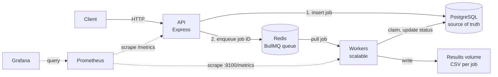
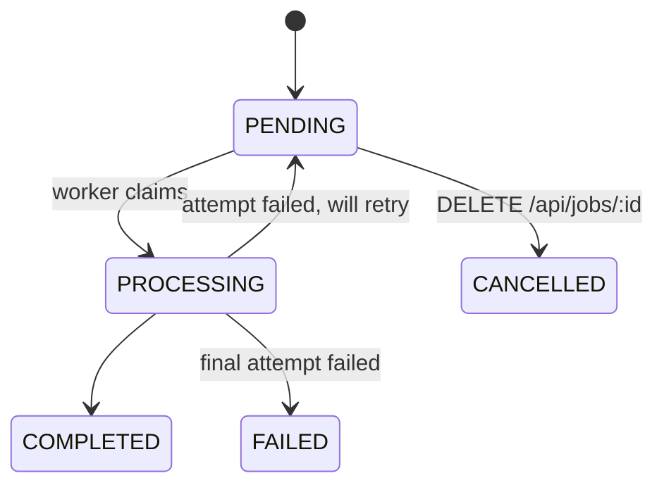

# Distributed Job Processing System

[](https://github.com/rahulrubugunday/distributed-job-system/actions/workflows/ci.yml)

A background job system in TypeScript. An HTTP API accepts work, Redis queues it, horizontally scalable workers process it, and PostgreSQL records every state change. It runs in Docker Compose and on Kubernetes, and it is instrumented with Prometheus, Grafana and k6 load tests.

**Highlights**

- Retries with exponential backoff, stalled job recovery after worker crashes, and graceful shutdown
- Idempotency keys enforced by a database constraint (5 concurrent duplicate requests produced 1 row)
- A reconciler that closes the gap between the Postgres write and the Redis enqueue
- Safe cancellation and job claiming using single atomic SQL updates
- Kubernetes deployment with probes, resource limits and a Horizontal Pod Autoscaler (scaled workers 1 to 6 under CPU load)
- Prometheus metrics, a Grafana dashboard provisioned as code, and k6 sustained load tests
- GitHub Actions CI: type check, tests against real Postgres and Redis, and Docker build

## Architecture



When a client submits a job, the API stores it in PostgreSQL as `PENDING`, adds its ID to the BullMQ queue, and returns `202 Accepted` immediately. A worker pulls the ID, claims the job by moving it to `PROCESSING`, does the work, writes a result file and marks it `COMPLETED`. Failed attempts are retried with backoff and end as `FAILED` after the last attempt. A `PENDING` job can be cancelled.



## Tech stack

| Layer | Choice |
| --- | --- |
| Language | TypeScript on Node.js 24 (run with tsx) |
| API | Express 5 |
| Database | PostgreSQL 16 with `pg` and hand written SQL migrations |
| Queue | Redis 7 with BullMQ |
| Tests | Jest, Supertest, @swc/jest |
| Containers | Docker, Docker Compose |
| Orchestration | Kubernetes (Kind), HPA, metrics-server |
| Observability | prom-client, Prometheus, Grafana |
| Load testing | k6 |
| CI | GitHub Actions |

## Design decisions

**PostgreSQL is the source of truth; Redis only delivers job IDs.** Every job is written to Postgres before it is queued, and status lives only there. If Redis lost its data, no job would be lost.

**The Postgres UUID is the BullMQ job ID.** One identifier ties both stores together, makes re-enqueueing a job a no-op, and lets cancellation remove the queue entry directly.

**A reconciler closes the dual write gap.** If the insert succeeds but the enqueue fails, the job is still safe in Postgres. Every 30 seconds the worker re-queues `PENDING` jobs older than one minute. A transactional outbox is the more rigorous option and is on the roadmap.

**Correctness is enforced by the database, not application code.** Idempotency keys use a `UNIQUE` column with `INSERT ... ON CONFLICT DO NOTHING`, which avoids the race in a check then insert. Claiming and cancelling use conditional `UPDATE ... WHERE status IN (...)` statements, so the API and workers can never both act on the same job.

**Raw SQL instead of an ORM.** I tried Prisma and removed it. The features I rely on most (`ON CONFLICT`, conditional updates) are clearest as plain SQL, and numbered migrations make every schema change explicit.

**One Docker image for the API and the worker.** The worker overrides the start command. Both always run the same code version.

**Metrics are pulled, and replicas are discovered by DNS.** Prometheus finds every worker through Docker's DNS, so scaling needs no config change. Only the API reports queue depth, so it is not counted once per worker.

## Results

### Burst benchmark: 6 jobs × 5 s of simulated work

| Configuration | Time | Speedup |
| --- | --- | --- |
| 1 worker | 30.089 s | 1.00x |
| 3 workers | 10.079 s | 2.99x |
| 1 worker, concurrency 3 | 10.043 s | 3.00x |
| 3 workers × concurrency 2 | 5.162 s | 5.83x |
| Same, DB pool size 1 | 5.163 s | 5.83x |

The single connection pool matched the full pool because workers only touch the database briefly to claim and update a job.

### Sustained load test (k6): 1 job/s for 2 minutes

Each worker runs at concurrency 2. End-to-end time is `completed_at - created_at` from Postgres.

| Workers | Jobs | API POST p95 | Throughput | End-to-end p50 | End-to-end p95 |
| --- | --- | --- | --- | --- | --- |
| 1 | 121 | 5.84 ms | 0.396 jobs/s | 95.2 s | 176.5 s |
| 3 | 120 | 7.58 ms | 0.968 jobs/s | 5.0 s | 5.0 s |

- **1 worker** (capacity about 0.39 jobs/s) could not keep up with 1 job/s, so the queue grew for the whole test. Its p95 depends on test length.
- **3 workers** (capacity about 1.17 jobs/s) kept up, so every job waited only for its own 5 s of work.
- **The API stayed under 8 ms in both runs.** Slow processing never slowed down accepting requests.
- Throughput rose about 2.4x, not 3x, because the 3 worker run was limited by the arrival rate, not by worker capacity.


## Running locally

Requirements: Docker Desktop.

```bash
# Download the code and move into the project folder
git clone https://github.com/rahulrubugunday/distributed-job-system.git
cd distributed-job-system

# Build the image and start every service in the background (-d):
# Postgres, Redis, the API, 3 workers, Prometheus and Grafana.
# Database migrations run automatically on the first start.
docker compose up -d --build
```

Give it a few seconds to start. `docker compose ps` should show the API as `healthy` before you send requests.

| Service | URL |
| --- | --- |
| API | http://localhost:3000 |
| Prometheus | http://localhost:9090 |
| Grafana | http://localhost:3001 (admin / admin, local only) |

Submit a job and check on it:

```bash
# Create a job. The API saves it to Postgres, queues it, and replies with a jobId straight away.
# The Idempotency-Key header is optional: sending the same key again returns the existing job instead of creating a duplicate.
curl -X POST http://localhost:3000/api/jobs \
  -H "Content-Type: application/json" \
  -H "Idempotency-Key: demo-1" \
  -d '{"type":"REPORT_GENERATION","payload":{"reportType":"monthly","startDate":"2026-10-01","endDate":"2026-10-31"}}'

# Look up the job using the jobId from the response.
# It shows PENDING or PROCESSING at first, and COMPLETED after about 5 seconds.
curl http://localhost:3000/api/jobs/<jobId>
```

Run the load test (k6 runs in Docker, nothing to install):

```bash
# Start a throwaway k6 container (--rm deletes it afterwards) on the project's Docker network,
# so it can reach the API at http://api:3000.
# RATE and DURATION set the load: here 1 job per second for 2 minutes.
# LABEL tags the jobs so this run can be measured separately in Postgres.
docker run --rm -i --network distributed-job-system_default \
  -e RATE=1 -e DURATION=2m -e LABEL=my-run \
  grafana/k6 run - < k6/submit-jobs.js
```

Open the Grafana dashboard during the test to watch the queue and throughput live. Change the number of workers for a run with `docker compose up -d --scale worker=1`, and run `docker compose up -d` afterwards to return to 3.

### Tests

```bash
npm ci              # install the exact dependency versions from package-lock.json
npx tsc --noEmit    # type check the code without producing output files
npm test            # run the API tests (needs Postgres and Redis running: docker compose up -d postgres redis)
```

### Kubernetes (Kind)

```bash
# Build the image and copy it into the Kind cluster named "jobs" (Kind can't see your local images otherwise)
docker build -t job-system:v3 .
kind load docker-image job-system:v3 --name jobs

# Store the SQL migrations in a ConfigMap so Postgres runs them on first start
kubectl create configmap postgres-migrations --from-file=db/migrations

# Create everything in the k8s/ folder: Postgres, Redis, the API, workers and the autoscaler
kubectl apply -f k8s/

# Forward port 3000 on your machine to the API inside the cluster (leave this running)
kubectl port-forward service/api 3000:3000
```

The HPA needs metrics-server installed in the cluster.

## API

| Method | Path | Description |
| --- | --- | --- |
| `POST` | `/api/jobs` | Submit a job. Optional `Idempotency-Key` header. Returns `202` for a new job, `200` for a duplicate key |
| `GET` | `/api/jobs/:id` | Get a job's status. `400` for an invalid UUID, `404` if not found |
| `DELETE` | `/api/jobs/:id` | Cancel a `PENDING` job. `409` if it has already started or finished |
| `GET` | `/health` | Health check |
| `GET` | `/metrics` | Prometheus metrics (workers serve theirs on port 9100) |

## Project structure

```
src/
  app.ts          Express app: routes, request metrics middleware
  server.ts       Starts the API, registers the queue depth gauge
  worker.ts       Job processor, retries, reconciler, metrics server, graceful shutdown
  db.ts           PostgreSQL connection pool
  queue.ts        BullMQ queue and Redis connection
  metrics.ts      Prometheus metric definitions
db/migrations/    Numbered SQL migrations (001 to 005)
tests/            Jest and Supertest API tests
k8s/              Kubernetes manifests (Postgres, Redis, API, worker, HPA)
prometheus/       Prometheus scrape config
grafana/          Provisioned data source and dashboard
k6/               Load test script
.github/workflows CI pipeline
```

## Roadmap

- Transactional outbox to replace the reconciler
- Shared result storage (S3 or MinIO) instead of a local volume
- Queue length autoscaling with KEDA
- zod validation, a paginated `GET /api/jobs`, and a central error handler
- Multi-stage Docker build and a migration runner that tracks applied migrations
- A load test above worker capacity to measure the 3 worker ceiling
